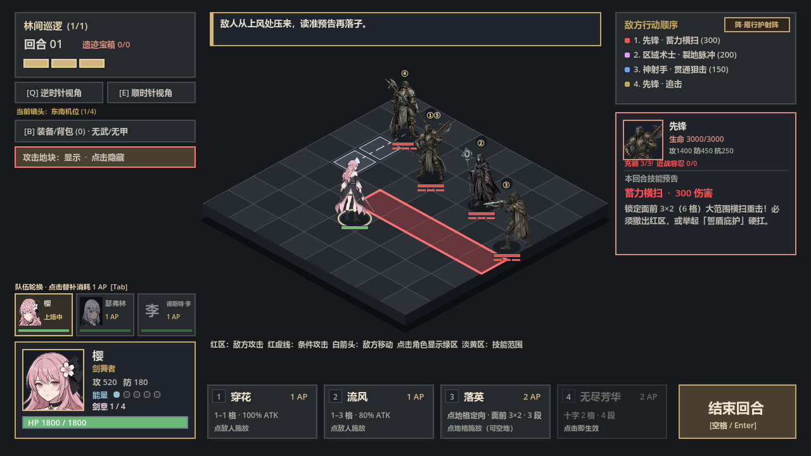
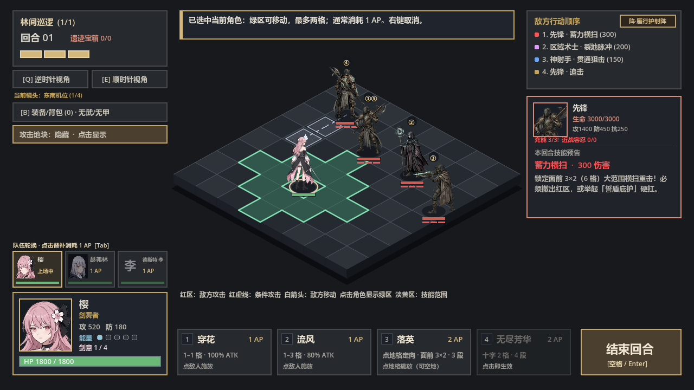
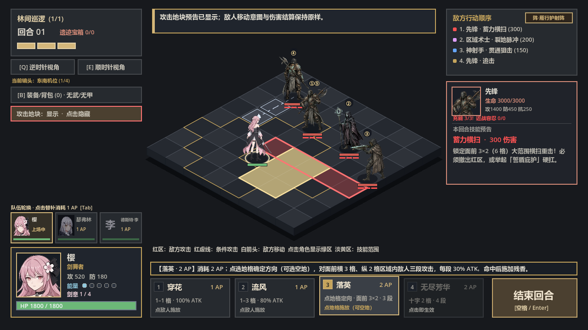
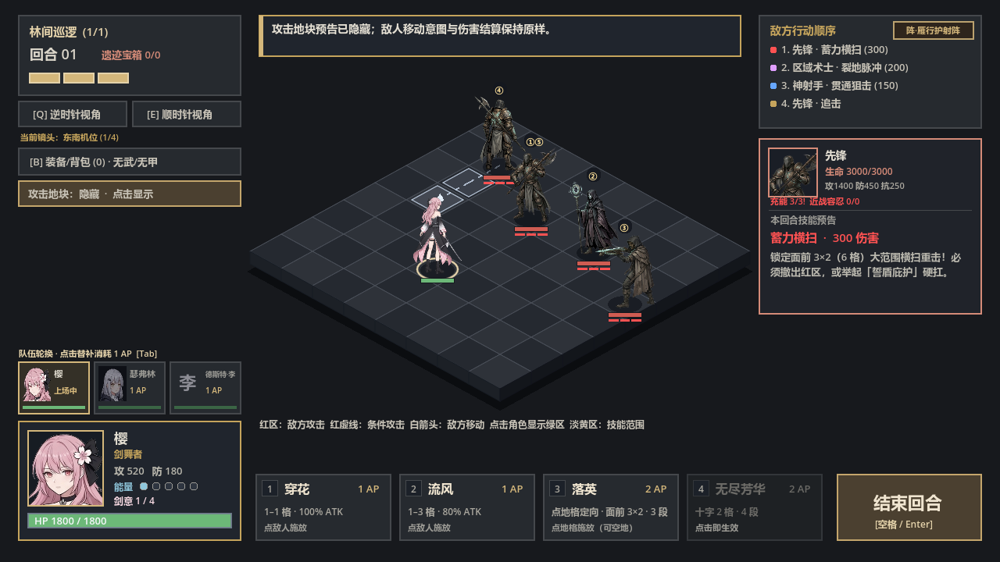

# 地块显示与生命快照收尾报告

本批从最新 main `52cc64e` 对接 #117～#124：测试目录隔离、残片上限来源、模块卸下、旧档续行数值和状态文档均已整合。先补齐 ECHO-207 的真实结算链路，再按开发者截图实施 ECHO-209 地块显示。技术栈保持 Godot 4.7.2 Standard / GDScript / Compatibility / 1280×720。

## 上轮遗留：实际结算后重复缩放

上游原探针已由 1800 修到 1890，装卸的单场测试也通过；但实际战斗结果仍将已缩放的 `hero_max_health=1890` 写入 `carry_max_health`。经过 `SpringRun.from_dict()`，旧同步函数把它再作为基础乘 1.05，得到 1985，当前生命从 945 变成 993。地图治疗也混用了基础上限与实际上限。

新增 `test_fragment_vitality_flow.gd`，修复前 28 条中 17 条失败。修复后通过真实战斗入口、`SpringBattleBridge.settle_result()`、地图 JSON 重载与再进战验证：

- `SpringVitality` 统一基础值、实际上限和地图同步；结算分别传递缩放前上限与当前实际上限。
- 三次真实结算、每次三次读档，均保持 1890 / 945，不重复乘模块；装卸模块只按当前生命比例搬运一次。
- 地图治疗可达到实际 1890 上限；地图增加上限已有显式治疗时，不再额外送一次比例治疗；退场角色不因同步复活。
- 对已有 `base_max_health` 来源的旧记录，可识别“已缩放 carry”并归回原始值；没有历史组成的模糊旧档继续保持保守兼容，不猜测历史比例。#123 的旧档续行修复保留。

## 移动显示逻辑检查结论

**未发现原移动规则与显示范围不一致。** 每次移动最多两步，按正交邻格寻找路径；两步对角目的地仅在存在合法折线路径时可达。障碍、存活单位和宝箱占格，替补不占格；通常花 1 AP，`echo_stride` 的当回合第一次免费移动在 AP 为零时仍可用。

`BoardMoveRange.cells()` 同时使用 `GridRules.find_path()` 与控制器同源的 `is_path_legal()`。新专项在四种 AP/免费移动场景下逐格对照实际 `request_player_move()` 的接受结果，覆盖障碍、敌人、替补原位置、当前格、超距和边界。切换显隐没有修改任何移动规则、收费或敌人充能。

移动范围默认隐藏。点击当前角色棋子或当前头像免费选中，显示均匀绿区与连续边界；右键取消、选技能、移动完成、换人、回合结束或新遭遇清除旧选区。保留原有直接点空地移动的操作方式。

## 地块与按钮

| 类型 | 当前显示 | 显隐与重叠处理 |
|---|---|---|
| 敌人移动意图 | 原白/银色地块、虚线箭头 | 绘制函数保持原样；攻击按钮不隐藏或修改移动路径 |
| 敌人攻击意图 | 单一红色内部、清晰连续红边 | 按地格集合合并，只画一次；不同类型、数量和顺序不加深，不再出现红/紫/蓝混色 |
| 条件攻击 | 红色虚线边界 | 仍区分“可能反击”与已锁定攻击；随攻击按钮隐藏 |
| 当前角色移动 | 均匀绿区、连续绿边 | 默认隐藏，点选角色后显示；没有 AP 且无免费移动时为空 |
| 选中技能覆盖 | 均匀淡黄色、连续浅金边 | 替换旧碎角标记；薄金轮廓表示可点选地格，填充区域表示本次技能实际覆盖 |

左侧背包按钮下新增「攻击地块：显示 / 隐藏」。按钮只修改显示状态，不改变敌人动作、路径、攻击结算或 AP；敌方演出中也可切换。暂停断点保存该选择，旧断点缺字段时默认显示攻击、隐藏移动。隐藏地块后仍保留右侧敌人列表及 HUD 的伤害风险信息。

三类区域使用不透明的柔和填充，消除原棋盘深浅底色和其他覆盖层的混色。选择区填充优先于攻击填充，攻击边界仍可见；因此黄色技能内部与绿色移动内部在危险格也保持一致。连续外边界之外仅留轻微格线，帮助计格，不恢复原碎角或彩色重叠标记。地面危害本体规则保持原样，关闭攻击显示可看回底层地形。

## 实际渲染

`tools/render_board_overlays.gd` 使用原生图形后端生成以下画面，并读取视口像素验证：单次/混合/重复攻击颜色相同、显隐不改敌人移动像素、交替底色上的绿区相同、技能内部均匀，以及恢复攻击显示不改变黄色内部。检查通过；它是程序驱动的视觉验证，真人 Windows 手感与性能验收仍待人工。









重现命令（隔离配置目录下运行，不加 `--headless`）：

```text
Godot --path . --audio-driver Dummy --script res://tools/render_board_overlays.gd
```

输出在忽略目录 `build/overlay-preview/`。常规回归为 `tests/run_all.ps1 -Godot <Godot 4.7.2 console>`，完整 Windows 包由 `tools/build_windows.ps1` 生成；最新规模与下限见 [BASELINE](BASELINE.md)，PR 附最终双端 CI 及构建证据。

## 仍待完成

- 缺乏历史比例来源的旧生命快照不能安全反推，本次没有擅自重算此类数据；更新前继续备份存档。
- Windows 真人交互、完整局、缩放和性能仍按既定安排交人工；原设备视角卡死尚未复现。
- Boss 额外特殊败北规则、Android、多回合预告及其他已暂缓内容没有新增决策。
