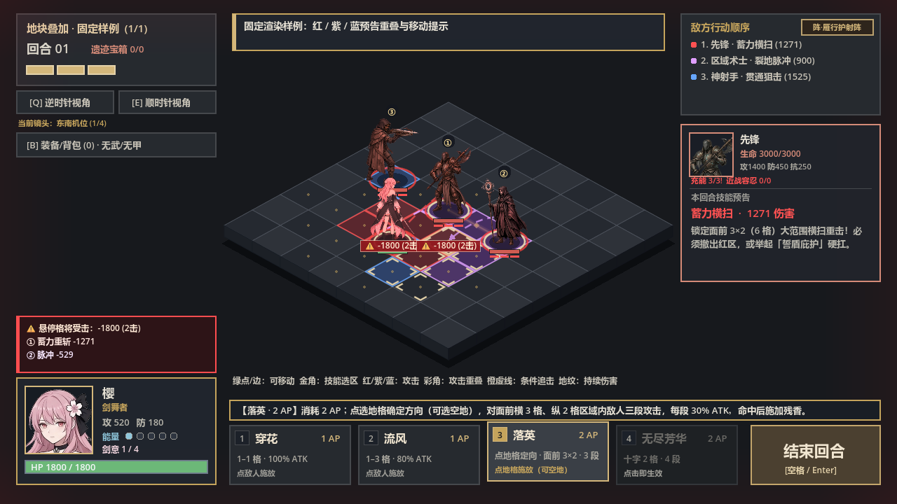

# 2026-11-27 实机问题修复记录

接续 #117～#124 后，本批进一步复现并修复战后缩放上限写回基础值，读档从 1890 变 1985 的剩余链路；同时按新截图改进地块显示。完整证据与当前结论见 [本批报告](BOARD_OVERLAYS_2026-11-28.md)。

后续规则更新：角色切换与队友行为已按开发者 2026-11-28 最新指令重做为单人轮换，见 [交付记录](SINGLE_ACTIVE_PARTY_2026-11-28.md)。本文件此前关于单领队装备和倒地复活的修复记录保留为历史，不作为新模式的当前规则。

审计基于 `4f2a412`（已包含 PR #76、#82、#86、#88 的主线结果），引擎为 Godot 4.7.2 Standard，Windows Compatibility / OpenGL 渲染。用户提供的编号为 1、2、3、4、5、7、8，共七项；未提供第 6 项。

## 问题、原因与实施

| 编号 / 级别 | 定位与原因 | 实施与影响范围 | 回归验证 |
|---|---|---|---|
| 7 / 高 | `spring_map_view.gd::_draw_revive_prompt()` 只画灰色，`_handle_revive_tap()` 仍处理点击；`continue_run()` 返回失败后，界面直接调用 `finish("defeat")`，把不可用操作变成结束本局。 | `SpringBattleBridge.can_continue()` 统一显示与点击判据；补给不足、次数已用、探索已结束均不可续行。只有成功才关闭提示并保存，拒绝操作不扣款、不结束、不写失败存档。 | 零补给、次数已用、补给恰好足够、重复点击，以及明确点击「结束本局」。 |
| 1 / 中 | `run_state.gd::_recompute_stats()` 增益时给当前生命加差值，减益时仅 clamp 至新上限。伤者卸装时没有回收此前加上的生命，因此反复穿脱可不断补血。 | 当前生命与上限都应用装备变更的有符号差值；存活者最低保留 1 HP，倒地者保持 0，不因换装复活。覆盖武器、护甲、换装及无 Actor 的跨场景状态。 | 有/无 Actor 分别连续穿脱五轮；两槽叠加、换成小加成护甲、倒地卸装。 |
| 3 / 中 | `board_threat_view.gd::draw_telegraphs()` 对每条意图重复叠色；悬停其他敌人时未聚焦预告亮度乘 0.22；移动、目标、悬停填充继续覆盖危险颜色。部分角色锁定技能仍画旧 `target_cell`。 | 新增 `BoardThreatTiles`：每格只画一种主填色，按红→紫→蓝→凋零→残春排序，以独立内缩边线保留其他攻击类型。悬停不再降低危险地格可见度；危险格的移动提示只用绿色内边线，金边表示技能选区，加入图例。角色锁定的色块、方向线、聚焦及危险查询使用当前目标位置。 | 红紫重叠、反转意图顺序仍同色、角色移动后的锁定位置、取消意图清除；OpenGL 截图核验叠色、绿色边线和落英范围预览。 |
| 4 / 中 | `battle_flow.gd::start_encounter()` 为部署校验预建角色；`board_objects_view.gd::draw_depth_sorted_objects()` 把该占位对象直接渲染，尚未部署的樱已站上棋盘。隐藏后若仍按占位格判碰撞，又会出现看不见的占用。 | 部署期间隐藏玩家实体，已选位置显示「就位」标记；确认部署后才显示立绘，并立即把视觉坐标对齐选定格。部署碰撞只认已就位队员，敌人和已就位队员仍挡格。 | 未部署、已选格但未确认、确认后的实体可见性与首帧坐标；双人部署允许使用未就位者的占位格，拒绝重叠就位。 |
| 5 / 中 | `sakura_skill_catalog.gd` 把落英声明成 `TARGET_ACTOR`；`SkillEffects._falling_petals()` 强制要求活敌人，甚至空范围也拒绝。界面没有地格施法路径。 | 落英改为 `TARGET_CELL`；`request_skill()` 增加可选地格参数，保留旧敌人 ID 调用。瞄准与效果共用 `area_cells()` / `CombatGeometry`，支持点击空地或完全打空，仍校验射程、地形、AP。结界按既有伤害倍率结算，宝箱不会被友军范围技能误伤。 | 点击空地命中前方敌人、完全空范围、自己脚下/越界/超距/隔墙拒绝、两 AP 即时扣除、结界伤害不额外收费；既有极意、残香、回锋与旧接口测试保留。 |
| 8 / 中 | 已确认界面接缝错误：选中技能后点击空地会落入移动分支并花 1 AP；成功后选择未清除。首次点击技能本来只选目标，不扣 AP；击杀还有既有的 +1 AP 返还，但界面没说明，容易产生“第一次免费”的观察。底层未复现延迟到第二次统一扣费。 | 新增 `BattleSkillInput` 管理选中/确认；单体技能的非法空地点选不会移动或扣费；成功后清除选择并恢复移动提示。反馈分别显示本次消耗、击杀返还和剩余 AP。费用维持目录值：穿花/流风 1 AP，落英/无尽芳华 2 AP。 | 四技能分别连续确认两次，逐次核对余额；选中不扣费、AP 不足不施法、1 AP 不能再放 2 AP 技能；击杀返还前两次生效、第三次不返还且文案一致。 |
| 2 / 待复现 | `battle_view.gd::_rotate_camera()` → `UiPalette.rotate_camera()` 为同步四象限转换，没有协程等待或锁；本轮未复现所述卡死。已发现旋转会保留旧投影下的悬停、突进向量与飘字。 | 切换后清除旧悬停与屏幕空间动画，重新对齐角色位置。保留敌方分步结算计时，避免切换打断回合推进。该改动不能视为已证实修复未知卡死根因。 | 自动回归通过实际点击入口旋转 128 次并等待绘制帧，逐格验证投影逆变换和 Actor 坐标；敌方演出中旋转仍正常进入下一回合。另以 NVIDIA RTX 4060 Laptop / OpenGL 3.3 实际渲染完成 128 次连续切换。 |

## 验证结果

新增 `tests/test_playtest_regressions.gd`，113 条断言。最初针对已有入口的 29 条断言中，25 条在修复前失败；修复后全部通过。后续补上樱四技能、击杀返还、部署、叠色、结界与连续旋转场景。

最终本地全量回归为 **40 套件 / 2926 断言 / 0 失败 / 0 broken**，七道守卫全部通过。跨平台结果以本 PR 的 `headless suites`、`windows suites` 和本地 `tests/run_all.ps1` 输出为准；工程快照同步到 [BASELINE.md](BASELINE.md)。原有教学、多人战斗、暂停/续玩、春之境探索/商店/事件/存档套件一并执行。

## 仍存在的事项与验证边界

- **视角卡死未复现**：需要发生卡死的具体遭遇、操作顺序、Godot 日志及设备信息才能进一步确定根因；本报告只确认压力场景通过和已定位的残留视觉状态得到清理。
- **AP 原始表象未在底层复现**：本次修复了可复现的误移动、选中状态和费用反馈，四技能逐次扣费测试通过；若仍出现首次命中无击杀却不扣 AP，应保留该次的技能名、AP 前后值和日志。
- **Boss 败北特殊规则**：按用户决定继续等待裁决，本批只修不可用续行误触，不替用户选择 Boss 规则。
- 这些自动化与渲染检查不能替代不同设备上的交互手感和长局人工验收；Windows 验收步骤见 [TESTER_WINDOWS_0.1.md](../../delivery/TESTER_WINDOWS_0.1.md)。

## 2026-11-28：单回合地块可读性跟进

用户指出当前单回合地块已经难读，因此多回合预告等旧草案扩展暂缓。固定三敌、红紫蓝攻击重叠的渲染夹具确认：多层完整菱形、移动内框、条纹、默认瞄准线和多处数值标签同时存在，造成同格信息拥挤。

当前画法为一个主填色/边框，其他攻击类型仅绘短角标；取消条纹并减缓闪动。安全可移动格保留绿边，危险可移动格用小绿点，避免再叠一圈完整绿色框。技能合法落点用浅金点提示，实际范围用金色短角；保留现有地形纹理和条件追击虚线。瞄准弧线与普通编队连线只在聚焦时显示，Boss 结界连线继续可见。降低屏幕红晕强度，角色脚下/悬停格保留承伤数值。

条件追击同样先按格合成：多个敌人的同格警戒只绘一次，取最高强调亮度，去掉额外橙色填充，不再覆盖主攻击填色；已取消意图不留警戒。新增四条行为断言验证覆盖、去重、强调和取消。

另外修正两个数值显示接缝：原标签仅在 intent.target_cell 建桶，范围边缘即便悬停也没有标签；聚焦还会过滤角色脚下其他敌人的来袭行。新 label_entries 按角色/悬停格直接调用既有顺序投影，保持完整承伤，不修改攻击范围、AP 或伤害公式。新增九条行为断言覆盖标签范围、边缘格、聚焦不漏项、去重、越界、取消和只读。

以下为 Godot 4.7.2 / Compatibility OpenGL / RTX 4060 Laptop / 1280×720 的自动固定渲染，主线与修改版使用相同三敌位置、攻击区、机位和冻结帧时间。它们用于核验图层收敛，不能代替真人对操作与观感的验收。说明图位于 docs，排除在游戏包外。

修改前：

修改后：

落英瞄准样例：

## 2026-11-28 当前游玩流程审计

依据 main `0ef0186`，Godot 4.7.2。检查正常标题/编队/出征交接、部署、切换、背包、地图效果、暂停恢复和独立战后结算；PR #111 的在途功能未纳入已实现范围。

| 严重度 | 位置与复现 | 根因 / 影响 | 修复与直接验证 |
|---|---|---|---|
| 高 | `battle_view.gd::_handle_inventory_tap()`：切到瑟弗林后给共享槽穿甲 | 单领队 RunState 却接收当前队员，整张领队面板覆写队友；药品也可污染领队存档 HP | BattleInventoryInput 收拢背包输入；装备指向既有领队，道具仍指向当前角色，使用后保留领队生命；正常部署/切换后的穿脱对称和队友治疗均验证 |
| 高 | `spring_battle_settlement_handoff.gd::open()`：暂停旧战斗，磁盘地图变成新局，再恢复并结算 | 优先读磁盘，把旧战果套到新地图与资源上，违背暂停快照的战前来源契约 | 有战前快照时只用该快照，非法快照拒绝；仅旧版无快照才读盘；真实保存/恢复后核对地图种子和花钿 |
| 中 | `spring_run.gd::heal_hero()/damage_hero()/add_bonus_max_health()` 与遗物发放：地图生效后进入下场 | hero 标量和 party_vitals 双份生命漂移，后者覆盖前者，消耗品/休息/损血/加上限失效 | 同步领队快照并在 prepare 对账健康旧副本；保留倒地，主动治疗才恢复生命；实际消耗型藏品、旧副本、存读档及进战覆盖 |
| 中 | `session_save.gd::valid()`：满 AP 使用沙漏后保存退出 | 上轮校验只允许 current≤基础 maximum，拒绝游戏合法的临时额外 AP，导致保存失败 | 道具和校验共用 APBudget 临时上限；4/3、5/3 可保存/恢复，6/3 拒绝，换回合仍归 3；这是对上一批过严校验的回归修正 |
| 中 | `spring_battle_settlement_handoff.gd::open()`：结算切场景失败后重试 | 提前清空战斗握手和战前快照，重试还会重建结算 ID，玩家看不到原因 | 保存战果后保留握手，接受切换才清理；重试复用持久 ID，界面说明失败；写入失败不切场景、不删断点，场景拒绝可重试 |

初始复现组 22 条中 10 条失败；修复后专项扩展为 61 条，额外确认倒地领队重载地图仍显示零生命。验证通过真实 Godot 场景、控制器请求、背包坐标命中和 JSON 存取驱动，使用独立 APPDATA 与进程专属文件。完整结果见 BASELINE 和实施 PR。

本轮没有代填人工画面/操作验收，也未宣称走完六种模板模式整局。仍需真人复测高亮可读性、缩放/焦点、手感、长局性能，以及未复现的原始旋转卡死和 AP 首次不扣表象；新发现的沙漏保存问题不等于原始 AP 表象已确定根因。Boss 败北、正式经济、Android 和多回合预告保持既有状态。每名角色独立装备尚无存档模型，本批保持既有单领队装备边界并在背包显示用途。

### 合并后追加：残片功能接缝

PR #111 在 #114 收尾时合入，主线基础回归通过。进一步按穿脱场景确认新缺陷：`RunState._recompute_stats()` 只取基础值和装备，会抹掉 BattleFlow 先前施加的残片百分比。原新增四条全失败：+4% 攻击的瑟弗林穿 +100 攻护甲应为 1300，脱下应为 1196；+1% 生命的上限与当前生命增减也应对称。

已修：BattleActor 捕获本场 `fragment_bonuses`，装备重算使用这份组成，不重读局外配置；组成随 JSON 快照保存，背包显示实际战斗面板。新百分比字段拒绝非法类型、负数、非有限值和未知属性。专项覆盖正常穿脱及恢复后穿戴。

**上述跨遭遇问题已于 2026-11-28 修复（ECHO-207）**：春之境已有队员生命快照时，下一战安装 +5% 生命模块，BattleFlow 生成的 1890 会被 `SpringBattleBridge.restore_party_vitals()` 用旧 1800 覆盖。现队伍快照记录 `base_max_health`，`PartyLoadout.restore_health` 仅在存档上限仍是缩放前基础值时保留重算上限；装 +5% 为 1890/945，卸下回 1800/900，跨战斗不重复缩放。`tools/probe_fragment_vitality.gd` 输出 expected=1890 / actual=1890 并退出 0。

旧档若已把含残片加成的上限写死、之后又卸下模块，无法反推原比例，保持存档值，不作不可逆重算。该边界已写回任务清单；工程包仍需真人验收。

## 2026-11-28：战后“保存未完成”的 JSON 回归（ECHO-210）

用户胜利后停在“战后奖励存档未完成，重试保存并返回”。读取原日志确认 `party_loadouts.base_max_health: expected int`。这是此前队员快照校验引入的回归：普通 Godot JSON 将整数读成 `1800.0`，`PartyLoadout.carry_error()` 却直接套用带整数类型标记的 SessionCodec 校验。三人战果因而被双文件事务误判为坏档；不是奖励消失或磁盘不足。

修复在普通地图 JSON 边界，只将已知整数字段中的有限、整值、int64 范围内数值规范为 int；同样处理队员装备属性、待结算战果里的 carry。保留只读校验、坏档拒绝及 SessionCodec 快照严格类型，不截断小数，不把字符串或布尔值转数字。正常旧档及已 prepared 的结算无需手工改档。

新增 `test_settlement_json_roundtrip.gd`：真实 JSON 文件、三人装备/生命、实际双文件事务、磁盘重启、连续领取、中断日志恢复及真实确认按钮。最初 19 条中 7 条失败，修复后扩展至 42 条通过；使用非默认工坊路径，确保不走无头测试的默认奖励旁路。过去的 `from_dict(to_dict())` 内存往返保留整数，未覆盖这个真实路径。

当前玩家文件仅作只读备份；在隔离副本中回放本次真实 prepared 记录，35 残晶只增加一次，重复确认保持余额，生命、金币及四件背包物品均保留，最终标记可清除。没有修改正在运行的原始存档；原件备份位于本地忽略目录 `build/recovery-backups/settlement-2026-11-28/`，不提交玩家资料。

恢复方法：退出旧程序，运行本次修复版本，通过“继续旅程”回到保留的战后结算，再点“返回春之境”。不要新开局、删存档或手动补发奖励。完整回归、Windows 构建和双端 CI 随实施 PR 记录，真人 Windows 验收仍保留。

## 2026-11-29：合法负属性装备误拒（ECHO-211）

新日志为 `pending_battle_settlement.result.party_loadouts: invalid equipment stat`。最新原档的 pending 战果中，瑟弗林装备 `weapon_dusk_blade`（黄昏破甲刃），数据目录明确为攻击 +340、防御 -60；校验却把装备修正量与角色最终属性都限制为非负，因而拒绝了正常战果。上次 JSON 类型修复没有覆盖这类合法负修正，属于存量校验的另一处回归。

本次按 `LootItemDefinition` 和 `RunState` 的现有语义接受有符号整数装备修正；角色基础值、生命及最终属性的非负/上下限校验保持，非法类型、小数、非有限值和溢出仍被拒绝。装备仍保留 +340 / -60 的代价，没有改装备数值或补偿发奖。

`test_settlement_json_roundtrip.gd` 从 42 扩展为 100 条：遍历目录全部武器/护甲，验证类型化快照、真实磁盘 JSON、真实双文件结算与重启幂等；追加替补穿负属性武器后的实际暂停/恢复，以及 pending→prepared→重启→确认按钮/连续点击。修复前目录/暂停场景复现 4 处失败；目录覆盖作为 CONTRACT 持续守卫，未来新装备自动纳入。

最新玩家原档再次只读备份到忽略目录 `build/recovery-backups/save-followup-20261128-235434/`。隔离副本通过真实结算界面准备、重启与确认：35 残晶只增加一次，生命、金币、完整装备/背包保持；武器 -60 防御保留，结算标记正常清除。玩家原件及交易日志没有修改，也不提交仓库。

恢复仍使用新版程序“继续旅程”并确认原结算；不需删档、重开或手工调整装备。最终全量、Windows 构建和双端 CI 见本批 PR。
