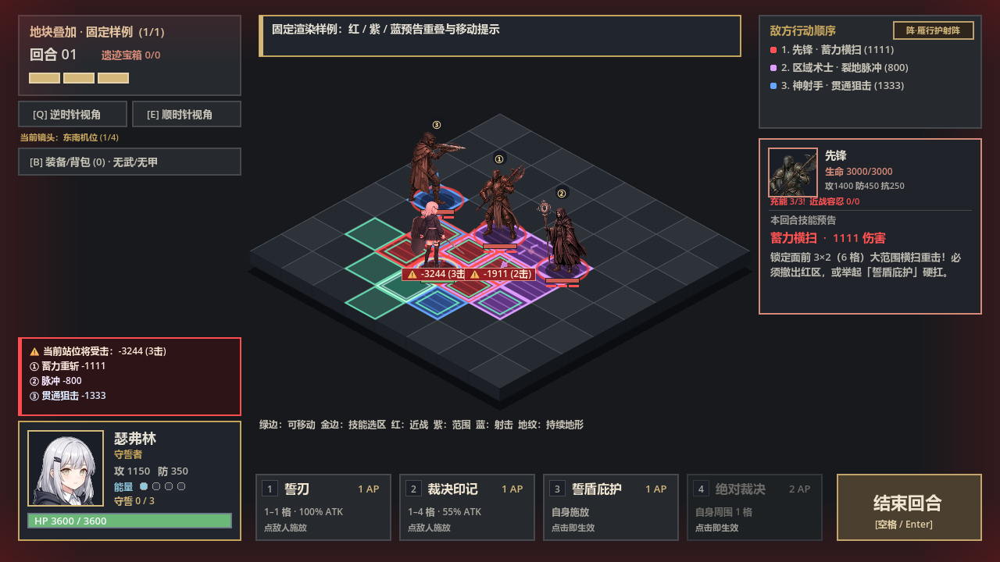
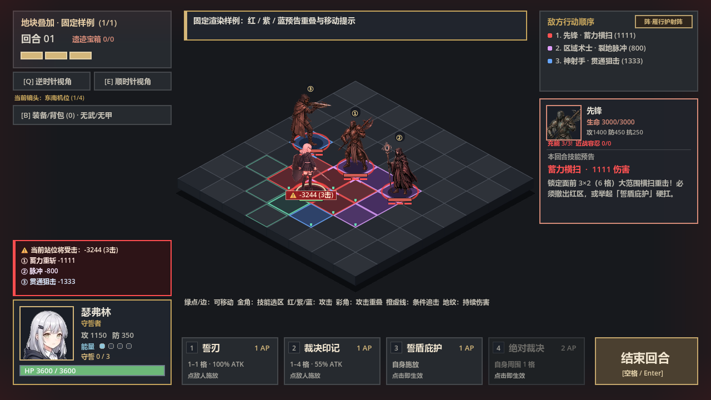

# 2026-11-27 实机问题修复记录

审计基于 `4f2a412`（已包含 PR #76、#82、#86、#88 的主线结果），引擎为 Godot 4.7.2 Standard，Windows Compatibility / OpenGL 渲染。用户提供的编号为 1、2、3、4、5、7、8，共七项；未提供第 6 项。

## 问题、原因与实施

| 编号 / 级别 | 定位与原因 | 实施与影响范围 | 回归验证 |
|---|---|---|---|
| 7 / 高 | `spring_map_view.gd::_draw_revive_prompt()` 只画灰色，`_handle_revive_tap()` 仍处理点击；`continue_run()` 返回失败后，界面直接调用 `finish("defeat")`，把不可用操作变成结束本局。 | `SpringBattleBridge.can_continue()` 统一显示与点击判据；补给不足、次数已用、探索已结束均不可续行。只有成功才关闭提示并保存，拒绝操作不扣款、不结束、不写失败存档。 | 零补给、次数已用、补给恰好足够、重复点击，以及明确点击「结束本局」。 |
| 1 / 中 | `run_state.gd::_recompute_stats()` 增益时给当前生命加差值，减益时仅 clamp 至新上限。伤者卸装时没有回收此前加上的生命，因此反复穿脱可不断补血。 | 当前生命与上限都应用装备变更的有符号差值；存活者最低保留 1 HP，倒地者保持 0，不因换装复活。覆盖武器、护甲、换装及无 Actor 的跨场景状态。 | 有/无 Actor 分别连续穿脱五轮；两槽叠加、换成小加成护甲、倒地卸装。 |
| 3 / 中 | `board_threat_view.gd::draw_telegraphs()` 对每条意图重复叠色；悬停其他敌人时未聚焦预告亮度乘 0.22；移动、目标、悬停填充继续覆盖危险颜色。部分角色锁定技能仍画旧 `target_cell`。 | 新增 `BoardThreatTiles`：每格只画一种主填色，按红→紫→蓝→凋零→残春排序，以独立内缩边线保留其他攻击类型。悬停不再降低危险地格可见度；危险格的移动提示只用绿色内边线，金边表示技能选区，加入图例。角色锁定的色块、方向线、聚焦及危险查询使用当前目标位置。 | 红紫重叠、反转意图顺序仍同色、角色移动后的锁定位置、取消意图清除；OpenGL 截图核验叠色、绿色边线和落英范围预览。 |
| 4 / 中 | `battle_flow.gd::start_encounter()` 为部署校验预建角色；`board_objects_view.gd::draw_depth_sorted_objects()` 把该占位对象直接渲染，尚未部署的樱已站上棋盘。隐藏后若仍按占位格判碰撞，又会出现看不见的占用。 | 部署期间隐藏玩家实体，已选位置显示「就位」标记；确认部署后才显示立绘，并立即把视觉坐标对齐选定格。部署碰撞只认已就位队员，敌人和已就位队员仍挡格。 | 未部署、已选格但未确认、确认后的实体可见性与首帧坐标；双人部署允许使用未就位者的占位格，拒绝重叠就位。 |
| 5 / 中 | `sakura_skill_catalog.gd` 把落英声明成 `TARGET_ACTOR`；`SkillEffects._falling_petals()` 强制要求活敌人，甚至空范围也拒绝。界面没有地格施法路径。 | 落英改为 `TARGET_CELL`；`request_skill()` 增加可选地格参数，保留旧敌人 ID 调用。瞄准与效果共用 `area_cells()` / `CombatGeometry`，支持点击空地或完全打空，仍校验射程、地形、AP。结界按既有伤害倍率结算，宝箱不会被友军范围技能误伤。 | 点击空地命中前方敌人、完全空范围、自己脚下/越界/超距/隔墙拒绝、两 AP 即时扣除、结界伤害不额外收费；既有极意、残香、回锋与旧接口测试保留。 |
| 8 / 中 | 已确认界面接缝错误：选中技能后点击空地会落入移动分支并花 1 AP；成功后选择未清除。首次点击技能本来只选目标，不扣 AP；击杀还有既有的 +1 AP 返还，但界面没说明，容易产生“第一次免费”的观察。底层未复现延迟到第二次统一扣费。 | 新增 `BattleSkillInput` 管理选中/确认；单体技能的非法空地点选不会移动或扣费；成功后清除选择并恢复移动提示。反馈分别显示本次消耗、击杀返还和剩余 AP。费用维持目录值：穿花/流风 1 AP，落英/无尽芳华 2 AP。 | 四技能分别连续确认两次，逐次核对余额；选中不扣费、AP 不足不施法、1 AP 不能再放 2 AP 技能；击杀返还前两次生效、第三次不返还且文案一致。 |
| 2 / 待复现 | `battle_view.gd::_rotate_camera()` → `UiPalette.rotate_camera()` 为同步四象限转换，没有协程等待或锁；本轮未复现所述卡死。已发现旋转会保留旧投影下的悬停、突进向量与飘字。 | 切换后清除旧悬停与屏幕空间动画，重新对齐角色位置。保留敌方分步结算计时，避免切换打断回合推进。该改动不能视为已证实修复未知卡死根因。 | 自动回归通过实际点击入口旋转 128 次并等待绘制帧，逐格验证投影逆变换和 Actor 坐标；敌方演出中旋转仍正常进入下一回合。另以 NVIDIA RTX 4060 Laptop / OpenGL 3.3 实际渲染完成 128 次连续切换。 |

## 验证结果

新增 `tests/test_playtest_regressions.gd`，113 条断言。最初针对已有入口的 29 条断言中，25 条在修复前失败；修复后全部通过。后续补上樱四技能、击杀返还、部署、叠色、结界与连续旋转场景。

最终本地全量回归为 **40 套件 / 2926 断言 / 0 失败 / 0 broken**，七道守卫全部通过。跨平台结果以本 PR 的 `headless suites`、`windows suites` 和本地 `tests/run_all.ps1` 输出为准；工程快照同步到 [BASELINE.md](BASELINE.md)。原有教学、多人战斗、暂停/续玩、春之境探索/商店/事件/存档套件一并执行。

## 仍存在的事项与验证边界

- **视角卡死未复现**：需要发生卡死的具体遭遇、操作顺序、Godot 日志及设备信息才能进一步确定根因；本报告只确认压力场景通过和已定位的残留视觉状态得到清理。
- **AP 原始表象未在底层复现**：本次修复了可复现的误移动、选中状态和费用反馈，四技能逐次扣费测试通过；若仍出现首次命中无击杀却不扣 AP，应保留该次的技能名、AP 前后值和日志。
- **Boss 败北特殊规则**：按用户决定继续等待裁决，本批只修不可用续行误触，不替用户选择 Boss 规则。
- 这些自动化与渲染检查不能替代不同设备上的交互手感和长局人工验收；Windows 验收步骤见 [TESTER_WINDOWS_0.1.md](../../delivery/TESTER_WINDOWS_0.1.md)。

## 2026-11-28：单回合地块可读性跟进

用户指出当前单回合地块已经难读，因此多回合预告等旧草案扩展暂缓。固定三敌、红紫蓝攻击重叠的渲染夹具确认：多层完整菱形、移动内框、条纹、默认瞄准线和多处数值标签同时存在，造成同格信息拥挤。

当前画法为一个主填色/边框，其他攻击类型仅绘短角标；取消条纹并减缓闪动。安全可移动格保留绿边，危险可移动格用小绿点，避免再叠一圈完整绿色框。技能合法落点用浅金点提示，实际范围用金色短角；保留现有地形纹理和条件追击虚线。瞄准弧线与普通编队连线只在聚焦时显示，Boss 结界连线继续可见。降低屏幕红晕强度，角色脚下/悬停格保留承伤数值。

另外修正两个数值显示接缝：原标签仅在 intent.target_cell 建桶，范围边缘即便悬停也没有标签；聚焦还会过滤角色脚下其他敌人的来袭行。新 label_entries 按角色/悬停格直接调用既有顺序投影，保持完整承伤，不修改攻击范围、AP 或伤害公式。新增九条行为断言覆盖标签范围、边缘格、聚焦不漏项、去重、越界、取消和只读。

以下为 Godot 4.7.2 / Compatibility OpenGL / RTX 4060 Laptop / 1280×720 的自动固定渲染，主线与修改版使用相同三敌位置、攻击区、机位和冻结帧时间。它们用于核验图层收敛，不能代替真人对操作与观感的验收。说明图位于 docs，排除在游戏包外。

修改前：

修改后：

落英瞄准样例：

