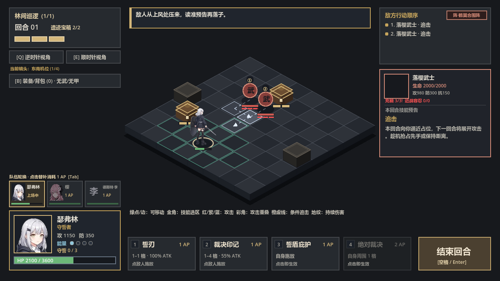
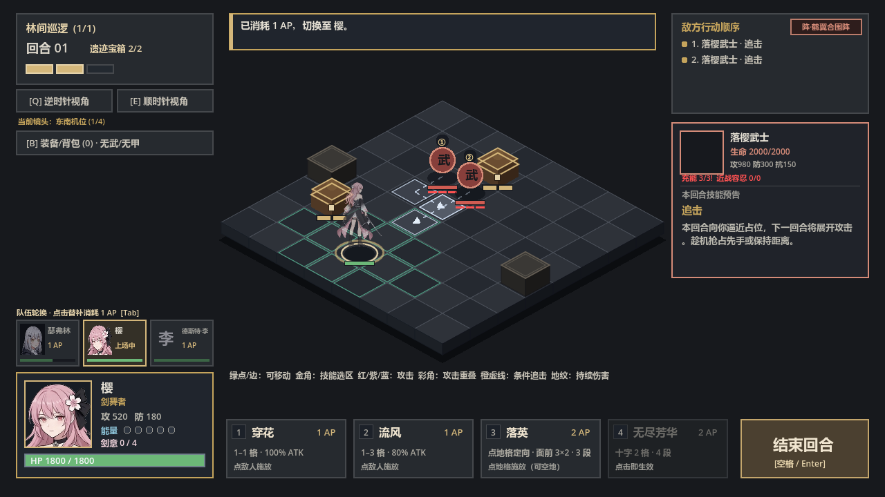
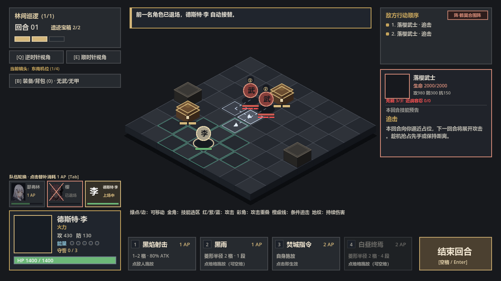

# 单人上场与队伍轮换交付记录

2026-11-28，基于 main `e7fb6c1`（PR #115）实施 ECHO-208。技术栈沿用 Godot 4.7.2 Standard、GDScript、Node2D 自绘战斗界面和 GL Compatibility。本次按开发者最新指令更改战斗规则；早期文档中的同时部署多人、免费切换指令、倒地原地复活及普通败北续行，不再作为新战斗的玩法依据。

## 当前规则

- 队伍最多三人，场上同一时间只有一名我方角色。替补不显示、不占格、不阻挡视线、不受攻击，也不能用护卫状态替场上角色承伤。
- 我方回合点击左下角色卡上方的队友头像，或按 Tab 轮换，消耗共享池的 1 AP。重复点击当前角色、AP 不足、敌方回合、部署阶段、战斗结束和已死亡角色均不能换人或扣费。
- 新角色出现在原角色所在格，不产生额外移动。各自的生命上限、当前生命、装备、护盾、能量、专属资源及状态保留；切换不会治疗、重置技能资源或刷新状态期限。状态仍按原回合边界到期。
- 主动换人依照既有 AP 规则为敌人充能。敌人对场上角色的锁定接续到替换者，已预告的范围、伤害与动作保持原值。
- 当前角色死亡后，本局永久退场，不留下倒地占格，不接受复活或再次选用。自动按原编队顺序寻找下一个存活角色，末位后回到首位；自动接替不消耗 AP，敌方剩余动作继续结算。
- 同一击范围伤害或一次回合开始的地格伤害，只命中该次结算开始时在场的角色，不连杀刚补上的替补。全员死亡结束本局，不用旧补给续行复活死亡角色。新开一局清除退场记录。
- 春之境下一场战斗、暂停读档保留死亡名单与每人的生命、装备归属。盾、能量、状态在同场换人与暂停恢复时保留；跨遭遇仍按既有战斗初始化规则处理。

## 定位与实施

| 问题 | 原因与位置 | 改动与验证 |
|---|---|---|
| 没有可点击的队友切换入口 | `HudView.draw_party()` 是空实现；`BattleView._switch_character()` 只免费改变操控 ID | `PartyPortraitView` 同源绘制/命中；鼠标与 Tab 均调用付费请求，切换时清除旧技能选区并重建技能栏 |
| 队友同时占格，敌人主要锁定当前指令角色 | `BattleFlow.start_encounter()` 部署整个编队；防守目标取当前角色 | `PartyRotation` 维护稳定编队与唯一上场者；替补通过 `BattleActor.is_benched` 从占格、渲染、攻击和护卫选择中排除；保留 `is_available()` 判断可轮换性 |
| 换人会串用装备/属性 | `RunState` 原先只有一个领队装备槽和属性基础 | `PartyLoadout` 保存每角色装备和基础，共享背包；切换仅更新工作槽，不重新生成角色或重算其当前战斗状态 |
| 死亡后无法继续操控或可能复活 | 原倒地模型保留身体与复活入口，自动交接只在下回合开始 | 伤害管线立即触发顺位接替；退场名单进入战斗与地图快照；全员死亡直接结束。兼容引擎层旧规则用例保留，新游戏场景统一启用轮换 |
| 一次范围攻击可能打死连续多个替补 | 伤害循环逐个读取角色是否在场，循环中死亡接替会改变这个集合 | 范围伤害和回合开始危害先固定本次目标，再结算；专项验证替补不会重复承受同一击 |
| 旧档装备归属可能迁错 | 旧免费切换改变操控者，原装备仍在编队首位，不能把旧工作槽当成当前角色装备 | 缺少新字段的断点保留原操控者上场，并把旧装备归还原领队；零生命旧队员迁移为退场，旧全灭档直接结束，不卡部署 |
| 下一关或返回地图可能丢失刚使用的治疗 | 每角色快照若只在换人时写入，会早于后续道具效果 | 进入下一关、保存和回地图前捕获当前角色；地图标量生命切换到存活的当前角色，并保持逐人生命快照 |

模块职责：`BattleController` 只提供请求入口；`PartyRotation` 决定上场、替补与敌人锁定接续；`PartyLoadout` 管装备工作槽和持久化组成；`SpringBattleBridge` 传递地图与战斗记录；`BattleSession` 迁移/恢复断点；`PartyPortraitView` 管头像栏；`BattleFxState` 持有有限时长的入场动画数据。动画使用淡入、向下落位与扩散金色光环，无协程等待或逻辑锁。连续点击在短动画结束前不会重复扣费。

## 画面

以下为真实 Godot Compatibility 渲染的 1280×720 画面，使用隔离测试存档。它们是程序驱动的视觉检查，不代表真人 Windows 游玩验收。

初始状态，只有瑟弗林在场：

点击樱后扣除 1 AP，在原格执行淡入/光环：

樱死亡，德斯特·李自动接替，樱头像标记退场：

## 验证与人工复测

自动化以 [BASELINE](BASELINE.md) 的最新实跑记录、PR 双端 CI 和 Windows 构建日志为准。新增 `test_party_rotation.gd`，从请求、真实场景点击、JSON 暂停恢复、地图结算与再次进战验证规则；原三套实机场景回归同步改为新的部署/装备/退场预期。保留低层原多人引擎规则的既有回归，避免迁移影响复用组件。

人工复测建议：

1. 编队三人进入春之境，只部署一人，确认替补原格可以行走。
2. 连续点不同头像及 Tab，确认每次有效切换只扣 1 AP；动画中重复点、AP 为零和敌方回合都不扣费。
3. 分别受伤、获得护盾/能量后往返切换，核对独立血条和技能栏；穿脱装备核对没有补血或属性串用。
4. 让敌人预告锁定后换人，确认攻击新上场角色，原角色不受伤。
5. 当前角色被击倒后观察自动接替、同击不连杀、后续敌人仍行动；再尝试点击死亡头像。
6. 换人动画中保存并返回标题，恢复后继续换人；通关进入下一战，确认死亡者仍不可选、生命和装备归属保留。
7. 全灭后结算，确认本局结束；新开一局确认角色恢复可用。

## 当前仍存在的问题

- **ECHO-207 / P1：已修复（2026-11-28）。** 根因是 `PartyLoadout.restore_health` 用旧队伍快照覆盖了已按残片重算的上限。队伍快照现记录 `base_max_health`（缩放前上限），装 +5% 模块为 1890/945、卸下回 1800/900、跨战斗不重复缩放，`tools/probe_fragment_vitality.gd` 输出 `actual=1890` 并退出 0。**边界**：旧档若已把含残片加成的上限写死、之后又卸下模块，无法反推原比例，保持存档值，不作不可逆重算。
- 视角卡死的原始设备场景尚未复现；保留此前压力回归，仍由人工复测。
- 队友头像、动画速度、窗口缩放、完整局难度和新 1 AP 轮换经济仍待人工签收。德斯特·李沿用现有“李”字棋子和头像占位；独立人物图像资源不在本次范围。
- 旧存档里零生命队员进入新战斗后会永久退场，这是最新死亡规则的兼容处理；更新前应按交付说明备份原存档。
- Boss 的额外特殊败北规则仍未另行决定；当前新战斗统一遵循本次明确的角色死亡/全灭规则。Android 与多回合预告保持暂缓。
